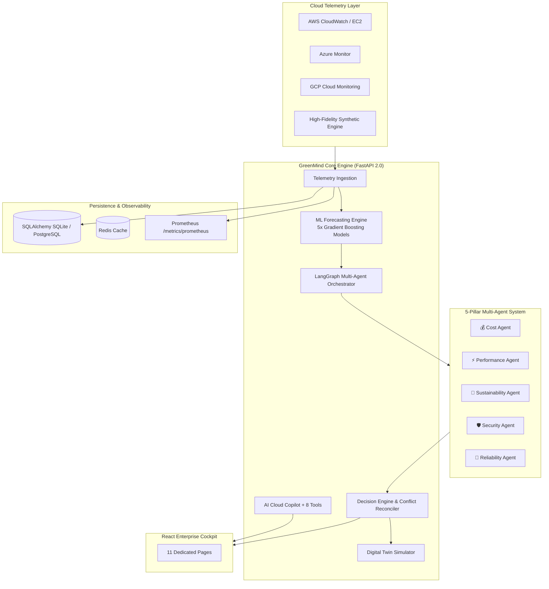

# 🌿 GreenMind AI — Autonomous Green Cloud Operating System

[](https://fastapi.tiangolo.com)
[](https://react.dev)
[](https://vitejs.dev)
[](https://scikit-learn.org)
[](https://github.com/langchain-ai/langgraph)
[](https://www.docker.com)
[](LICENSE)

> **GreenMind AI** is an enterprise-grade Autonomous Green Cloud Operating System designed to monitor, forecast, and optimize multi-cloud infrastructure across **AWS**, **Azure**, and **GCP**.
>
> By uniting **5-metric Machine Learning forecasting**, a **LangGraph-driven multi-agent AI system** with transparent conflict resolution, an infrastructure **Digital Twin simulator**, and an **Explainable AI Copilot**, GreenMind AI empowers engineering and FinOps/GreenOps teams to cut cloud costs and Scope 2 carbon emissions simultaneously.

---

## 📋 Status Breakdown

### 🟢 IMPLEMENTED
- **Continuous Integration & Image Publishing**: GitHub Actions checks Python 3.11/3.12 backend tests, Node 22 frontend lint/typecheck/build, and Docker/Compose configuration. The image workflow publishes GHCR images for tags or manual runs; Render independently auto-deploys from `main`. Publishing an image does not deploy it. GHCR frontend builds require repository Actions variables `VITE_SUPABASE_URL` and `VITE_SUPABASE_PUBLISHABLE_KEY`.
- **Automated Test Suite**:
  - `test_ml.py`: Validates all 5 trained Gradient Boosting models (`cpu_model.pkl`, `memory_model.pkl`, `network_model.pkl`, `cost_model.pkl`, `carbon_model.pkl`), temporal persistence baselines ($\hat{y}_t = y_{t-1}$), feature importances, and chronological validation criteria.
  - `test_agents.py`: Validates individual execution of all 5 domain agents (Cost, Performance, Sustainability, Security, Reliability), nullable guest OS memory handling, and transparent conflict resolution.
  - `test_digital_twin.py`: Validates mathematical calculations for `RIGHT_SIZE`, `SCALE_UP`, `SCALE_DOWN`, `CONSOLIDATE`, and `REGION_MIGRATION` scenarios with simulation persistence.
  - `test_copilot.py`: Validates contextual Copilot question answering, tool execution across all 8 tools, evidence citation, and action recommendation triggers.
  - `test_cloud_connectors.py`: Validates provider factory, demo mode fallback, and live API mock parsing for AWS, Azure, and GCP.
  - `test_cloud_providers.py`: Validates 4-tier provider status (`NOT_CONFIGURED`, `CONNECTED_DEMO`, `CONNECTED_LIVE`, `ERROR`), live STS/OAuth/JWT authentication, and credential validation.
  - `test_settings.py`: Validates zero-secret-leakage status endpoint, live provider connection test execution, session credential configuration, disconnect resets, and dual `/api/v1` path routing.
  - `test_telemetry_persistence.py`: Validates authenticated API persistence, owner-scoped durable history, and multi-granularity history queries (`5m`, `15m`, `1h`, `1d`).
  - `test_api.py`: Smoke and integration checks for selected health, telemetry, analytics, prediction, recommendation, agent, digital-twin, Copilot, cloud-resource, Prometheus, and CORS endpoints.
  - `test_cors.py`: Confirms configured origins pass CORS preflight and unknown origins are rejected.
  - `test_user_data_isolation.py`: Covers auth context scoping, separate telemetry/recommendation state, encrypted per-user credentials, and AWS environment credential isolation.
- **Multi-Cloud Telemetry Connectors & Live Verification**:
  - **AWS**: CloudWatch EC2 metrics via `boto3` ([aws_collector.py](backend/app/services/aws_collector.py)). Real connection test using `sts:GetCallerIdentity` and `cloudwatch:ListMetrics`. Minimum IAM: `ec2:DescribeInstances`, `cloudwatch:GetMetricData`, `cloudwatch:ListMetrics`.
  - **Azure**: Direct Azure Monitor REST API client with OAuth2 client-credential token acquisition and subscription status validation ([azure_provider.py](backend/app/cloud/azure_provider.py)). Minimum Role: `Monitoring Reader`.
  - **GCP**: Google Cloud Monitoring v3 client with official `google.oauth2.service_account` JWT authentication and metric descriptor validation ([gcp_provider.py](backend/app/cloud/gcp_provider.py)). Minimum Roles: `roles/monitoring.viewer`, `roles/compute.viewer`.
  - **Zero-Config Demo Mode**: Automatic, high-fidelity fallback when credentials are absent without fabricating live status.
- **Interactive Multi-Cloud Settings & Security Cockpit** ([SettingsPage.tsx](frontend/src/pages/SettingsPage.tsx)):
  - Real runtime connection testing with detailed caller feedback (e.g. IAM ARN, Subscription Name).
  - Runtime credential configuration and one-click Disconnect to Demo mode.
  - Per-user cloud credentials are encrypted in the backend database with `CREDENTIAL_ENCRYPTION_KEY`; plaintext secrets are not returned by API responses.
- **Enterprise Dark React Cockpit (All 11 Dedicated Pages)**:
  1. `Overview Dashboard` ([DashboardPage.tsx](frontend/src/pages/DashboardPage.tsx)): provider telemetry cards and history charts with live, demo, unavailable, and error source labels.
  2. `Cloud Resources` ([CloudResourcesPage.tsx](frontend/src/pages/CloudResourcesPage.tsx)): Searchable provider inventory with right-sizing flags and explicit unavailable status when the inventory request fails.
  3. `Predictions` ([PredictionsPage.tsx](frontend/src/pages/PredictionsPage.tsx)): 60-minute multi-metric forecasting and model evaluation telemetry.
  4. `Cost Optimization` ([CostOptimizationPage.tsx](frontend/src/pages/CostOptimizationPage.tsx)): Spend curve, underutilization detection, and instant scenario simulator.
  5. `Carbon Intelligence` ([CarbonIntelligencePage.tsx](frontend/src/pages/CarbonIntelligencePage.tsx)): 24-hour grid carbon intensity curve, regional clean energy ranking, and time-shift scheduler.
  6. `AI Recommendations` ([RecommendationsPage.tsx](frontend/src/pages/RecommendationsPage.tsx)): Recommendation ledger with Explain and dry-run preview. Live apply and rollback are not implemented.
  7. `Multi-Agent AI` ([AgentsPage.tsx](frontend/src/pages/AgentsPage.tsx)): Visual orchestration flow, domain scores, and transparent conflict resolution matrix.
  8. `Digital Twin` ([DigitalTwinPage.tsx](frontend/src/pages/DigitalTwinPage.tsx)): Interactive simulation workbench for all 5 scenarios (including Region Migration).
  9. `AI Copilot` ([CopilotPage.tsx](frontend/src/pages/CopilotPage.tsx)): Natural language interface grounded in current backend telemetry and analysis tools.
  10. `Analytics` ([AnalyticsPage.tsx](frontend/src/pages/AnalyticsPage.tsx)): Historical spend and carbon analytics with provider breakdowns.
  11. `Settings` ([SettingsPage.tsx](frontend/src/pages/SettingsPage.tsx)): Fully functional credentials tester, provider connector, and architecture inspector.
- **Production Deployment Blueprints & Guides**:
  - **Render & Vercel Connection Guide** ([DEPLOYMENT.md](DEPLOYMENT.md)): Complete step-by-step walkthrough to deploy and connect Render.com backend with Vercel.com frontend.
  - **Render Backend Blueprint** (`render.yaml`): Render auto-deploys the backend from `main`, binds to dynamic `$PORT`, and checks `/health`.
  - **Vercel Frontend Configuration** (`vercel.json` and `frontend/vercel.json`): SPA routing with client-side history rewrites and dynamic `VITE_API_BASE_URL` support.
- **5-Metric ML Forecasting Pipeline**: Separate Gradient Boosting models for CPU, Memory, Network, Cost, and Carbon. Chronological train/test split without data leakage. Real MAE, RMSE, and R² scores recorded and exported.
- **Explainable AI (XAI)**: Every recommendation provides What Detected, Why It Matters, Evidence, Recommendation, Expected Impact, and real ML Feature Importance (`feature_importance.json`).
- **LangGraph Multi-Agent Architecture with Conflict Resolution**: 5 specialized agents (Cost, Performance, Sustainability, Security, Reliability) with explicit transparent conflict resolution (`resolve_conflicts()`).
- **Digital Twin Simulation Engine**: Non-destructive simulator evaluating Before vs After for `RIGHT_SIZE`, `SCALE_UP`, `SCALE_DOWN`, `CONSOLIDATE`, and `REGION_MIGRATION`. Labeled `SIMULATED / ESTIMATED`.
- **AI Cloud Copilot Engine**: Natural language query processing grounded in 8 tools (`get_cloud_metrics`, `get_history`, `get_predictions`, `get_cost_analysis`, `get_carbon_analysis`, `get_recommendations`, `get_cloud_health`, `run_digital_twin_simulation`). Cites data sources without hallucinating.
- **Database & Persistence**: Async SQLAlchemy ORM supporting SQLite (`greenmind.db`) for demo/dev and PostgreSQL for production. Authenticated telemetry requests persist history under the signed-in user; an owner-scoped in-memory buffer supports fallback reads. Optional Redis caching.
- **Prometheus Monitoring & Observability**: Middleware & exposition at `/metrics/prometheus` tracking request rates, latencies, prediction counts, errors, and agent execution times. Grafana automated datasource and dashboard provisioning.
- **Security Hardening**: PostgreSQL and Redis in `docker-compose.yml` are bound strictly to localhost loopback (`127.0.0.1`), secrets are parameterized via environment variables, and Docker healthchecks are implemented.
- **Unified Clean API Router**: Complete root and `/api/v1/` routes preserving all legacy and existing endpoints.

---

### 🔑 OPTIONAL / REQUIRES CREDENTIALS
- **Live Cloud Credentials**: Each signed-in user can configure AWS, Azure, or GCP credentials in Settings. Those credentials are encrypted and isolated by Supabase user ID; backend environment credentials are reserved for system-managed operations.
- **LLM-Enhanced Copilot**: Each signed-in user can save an OpenAI or Gemini key in Settings. Keys are shown as saved but unverified; Copilot uses deterministic telemetry reasoning when no user key is saved or an optional provider SDK/API call fails.
- **Production PostgreSQL & Redis**: Activated when `DATABASE_URL` and `REDIS_URL` are set; falls back to async SQLite and in-memory ring buffers otherwise.

---

### 🔮 PLANNED
- **Direct Cloud Remediations**: Not implemented. Recommendation apply and rollback requests return HTTP 501; dry-run previews do not modify resources.
- **Automated Spot Interruption Re-balancing**: Proactive migration of stateless workloads before Spot termination notices fire.

---

## 🏛️ System Architecture



---

## 🔮 Machine Learning Pipeline

The ML pipeline forecasts cloud demand across 5 dimensions 60 minutes into the future without data leakage (chronological split):

### Model Evaluation Telemetry (Test Set)

Evaluated chronologically against genuine temporal persistence baselines ($\hat{y}_t = y_{t-1}$ on the metric's own historical values):

| Target Metric | Model Architecture | MAE | RMSE | R² Score | Baseline Improvement |
| :--- | :--- | :---: | :---: | :---: | :---: |
| **CPU Utilization (%)** | GradientBoostingRegressor | **3.809%** | 4.811% | 0.855 | **+41.4%** vs persistence (6.500) |
| **Memory Utilization (%)** | GradientBoostingRegressor | **2.979%** | 3.704% | 0.636 | **+25.4%** vs persistence (3.996) |
| **Network Traffic (Mbps)** | GradientBoostingRegressor | **43.876** | 55.328 | 0.871 | **+45.4%** vs persistence (80.346) |
| **Hourly Cost (USD/hr)** | GradientBoostingRegressor | **$0.009** | $0.011 | 0.474 | **+29.7%** vs persistence ($0.013) |
| **Carbon Intensity (gCO₂/hr)** | GradientBoostingRegressor | **4.061** | 5.087 | 0.391 | **+30.5%** vs persistence (5.846) |

---

## 🤖 Multi-Agent Architecture & Transparent Conflict Resolution

The multi-agent system coordinates 5 specialized domain agents:
- **Cost Agent**: Identifies over-provisioned VMs, idle storage volumes, and right-sizing targets.
- **Performance Agent**: Detects latency risks, capacity saturation, and scaling requirements.
- **Sustainability Agent**: Evaluates grid carbon intensity curves and recommends time-shifting batch compute to green windows.
- **Security Agent**: Audits security group exposure and enforces encryption standards.
- **Reliability Agent**: Verifies multi-AZ redundancy and backup SLA compliance.

### Transparent Conflict Reconciler
Opposing recommendations are never hidden:
- **High CPU Workload (>75%)**: Reconciles to `SCALE_UP_CONSTRAINED` to safeguard SLAs while enforcing auto-scaling step-down rules.
- **Moderate CPU Workload (<35%)**: Reconciles to `RIGHT_SIZE_WITH_PREDICTIVE_AUTOSCALING` to capture up to 35% savings while maintaining instant burst capacity.
- **Off-Peak Batch Jobs**: Reconciles to `TIME_SHIFT_NON_CRITICAL_WORKLOADS` during low-carbon grid windows.

---

## 🧪 Digital Twin Simulation Engine

The Digital Twin (`/digital-twin/simulate` and `/digital-twin/scenario`) evaluates the before and after impacts of 5 standard scenarios:
- `RIGHT_SIZE`: Instance family modernization and rightsizing (e.g., m5.xlarge -> m5.large).
- `SCALE_UP`: Compute expansion for peak traffic protection.
- `SCALE_DOWN`: Idle instance reclamation and downsizing.
- `CONSOLIDATE`: Node bin-packing and cluster compaction.
- `REGION_MIGRATION`: Geographically shifting workloads to lower-carbon grids (e.g., to ca-central / eu-west).

All outputs evaluate Before vs After metrics, risk assessments, and compute baseline vs projected optimization scores using the unified scoring service. Values are explicitly marked **`SIMULATED / NON-DESTRUCTIVE`**.

---

## 📊 Unified Optimization Scoring Methodology

GreenMind AI computes a holistic, bounded Optimization Score (0–100) across 5 core cloud architecture dimensions:
- **Cost Optimization Score (0–100)**: Evaluates compute utilization efficiency. Optimal band: 30%–75%. Heavy penalty for idle instances (<10% CPU). Valid 0.0% CPU readings are scored as severe idle waste, not treated as missing.
- **Performance & Headroom Score (0–100)**: Safeguards against saturation risks (>75% latency queueing penalty, >90% throttling risk, >90% memory OOM risk).
- **Sustainability Score (0–100)**: Normalized against global regional grid boundaries (clean hydro/nuclear baseline ~79 gCO₂/kWh up to fossil-heavy ~720 gCO₂/kWh).
- **Security Score (0–100)**: Assesses IAM configuration, encryption, and public surface area. Explicitly marked as `ESTIMATED` until live CSPM/Security Hub integration is connected.
- **Reliability Score (0–100)**: Evaluates multi-AZ redundancy and SLA compliance. Explicitly marked as `ESTIMATED` until multi-AZ agent probes are configured.

### Score Lifecycle
1. **Baseline / Real State**: Derived from current telemetry (either verified live provider metrics or synthetic demo telemetry).
2. **Dry-Run Preview**: Simulates the recommendation impact, returning baseline score, projected score, score delta, and assumptions without altering the current infrastructure state or claiming real remediation.
3. **Digital Twin Simulation**: The user can simulate recommendations into a persistent twin session (`POST /recommendations/{id}/simulate`), projecting simulated metrics and updating the dashboard score until explicitly reset via `POST /recommendations/reset-simulation`.
4. **Live Cloud Remediation**: Protected with strict HTTP 501 until full provider mutation and automated rollback capabilities are implemented.

---

## 📡 API Reference Directory

| Method | Endpoint | Description |
| :--- | :--- | :--- |
| `GET` | `/` | Platform status, version, and endpoint sitemap |
| `GET` | `/health` | System health, database, Redis, and LLM connection status |
| `GET` | `/metrics` | Current live telemetry or explicitly labeled demo telemetry (CPU, Memory, Storage, Network, Cost, Carbon) |
| `GET` | `/metrics/prometheus` | Prometheus openmetrics exposition format |
| `GET` | `/history` | Recent historical telemetry entries |
| `GET` | `/cloud-metrics` | Telemetry endpoint (preserves demo mode backward compatibility) |
| `POST`| `/predict` | Legacy CPU prediction endpoint |
| `GET` | `/predictions` | 60-minute multi-metric forecasts across all 5 dimensions |
| `GET` | `/recommendations` | Active AI recommendations with priority and category filters |
| `GET` | `/api/v1/recommendations/{id}/explain` | Explainable AI attribution with real model feature importances |
| `POST`| `/api/v1/recommendations/{id}/apply` | Dry-run preview; returns baseline and projected scores. Live mutations return HTTP 501 |
| `POST`| `/api/v1/recommendations/{id}/simulate` | Simulate recommendation in Digital Twin and project score update |
| `POST`| `/api/v1/recommendations/reset-simulation` | Reset Digital Twin simulation and restore baseline score |
| `GET` | `/api/v1/analytics/score` | 5-dimension optimization scores with baseline, projection, and assumptions |
| `GET` | `/cost-analysis` | Longitudinal spend curve, total USD, and top cost drivers |
| `GET` | `/carbon-analysis` | Carbon emissions curve, green hours %, and regional comparison |
| `GET` | `/agents` | List registered intelligence agents and status |
| `POST`| `/agents/run` | Execute LangGraph multi-agent analysis with conflict resolution |
| `POST`| `/api/v1/digital-twin/scenario` | Run non-destructive scenario simulations with baseline and projected scores |
| `POST`| `/digital-twin/simulate` | Custom infrastructure change simulation |
| `POST`| `/digital-twin/scenario` | Standard scenario simulation (RIGHT_SIZE, SCALE_UP, etc.) |
| `POST` | `/copilot/chat` | AI Cloud Copilot chat grounded in current provider telemetry and analysis tools |
| `GET` | `/cloud/providers` | List supported cloud providers and operational modes |
| `GET` | `/cloud/resources` | Cloud resource inventory with right-size candidate tags |

---

## 🚀 Getting Started

### Local Development (Zero Docker Required)

#### Prerequisites
- Python 3.11+
- Node.js 22+

#### 1. Backend Setup
```bash
# Clone repository
git clone https://github.com/Pratham-stack-coder/GreenMind-AI.git
cd GreenMind-AI

# Create virtual environment & install dependencies
python -m venv .venv
source .venv/bin/activate  # On Windows: .venv\Scripts\activate
pip install -r backend/requirements.txt

# Run backend test suite
PYTHONPATH=backend pytest backend/tests -v

# Start FastAPI backend (http://localhost:8000)
uvicorn backend.app.main:app --host 0.0.0.0 --port 8000 --reload
```

#### 2. Frontend Setup
```bash
cd frontend
cp .env.example .env
# Set VITE_SUPABASE_URL and VITE_SUPABASE_PUBLISHABLE_KEY for your Supabase project.
# Keep VITE_API_BASE_URL blank to use the local Vite proxy.
npm ci
npm run lint
npm run build
npm run dev     # Starts Vite dev server on http://localhost:5173
```

---

### Docker Deployment

To launch the full stack including PostgreSQL, Redis, backend, and frontend, first copy the root environment template and set the Supabase project URL, frontend publishable values, and a stable Fernet encryption key:
```bash
cp .env.example .env
# Set SUPABASE_URL, VITE_SUPABASE_URL, VITE_SUPABASE_PUBLISHABLE_KEY,
# and CREDENTIAL_ENCRYPTION_KEY. The VITE values are public; never use a service-role key.
docker compose up -d --build
```

To include optional Prometheus and Grafana monitoring:
```bash
docker compose --profile monitoring up -d
```

- **Frontend Cockpit**: `http://localhost:5173`
- **FastAPI API & Swagger Docs**: `http://localhost:8000/docs`
- **Prometheus Metrics**: `http://localhost:8000/metrics/prometheus`
- **Grafana (monitoring profile)**: `http://localhost:3000` (User: `admin`, Pass: `admin`)

---

## 🛡️ Security & Environment Configuration

Copy the template configuration:
```bash
cp .env.example .env
```

Backend configuration is loaded from environment variables:
- `SUPABASE_URL` (required for authenticated API requests)
- `CREDENTIAL_ENCRYPTION_KEY` (required before users can save cloud credentials in Settings; generate once with `python -c "from cryptography.fernet import Fernet; print(Fernet.generate_key().decode())"` and keep it stable)
- `DEMO_MODE=true` (the checked-in `.env.example` selects demo mode)
- `DATABASE_URL` (blank uses local SQLite `greenmind.db`; production should use PostgreSQL)
- `REDIS_URL` (optional cache)
- `OPENAI_API_KEY`, `GEMINI_API_KEY` (optional server-configured Copilot keys)

Cloud credentials entered in Settings are scoped to the authenticated Supabase user and stored encrypted in the database. Existing records without an owner remain inaccessible after the tenant migration. Backend environment credentials are never used as a fallback for signed-in user requests.

*.env, *.pem, private keys, and database files are strictly excluded via .gitignore.*
